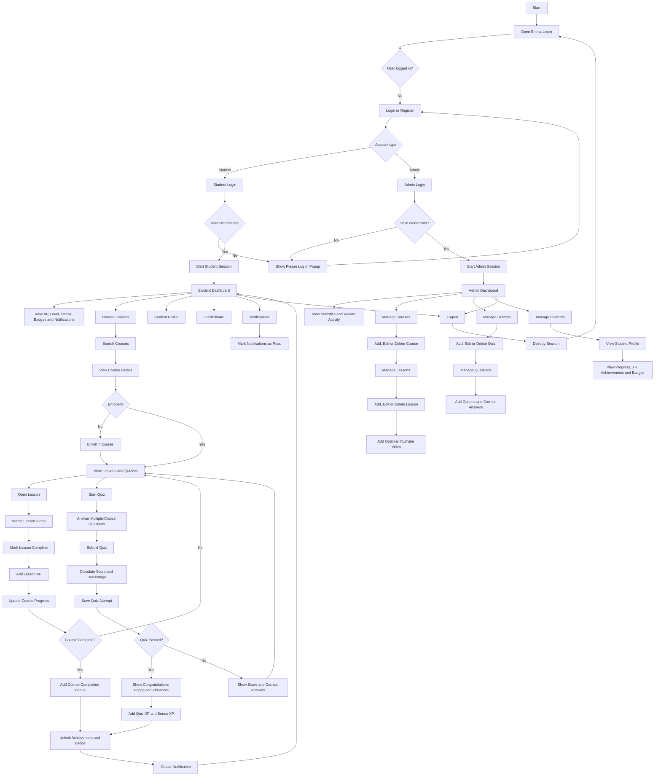
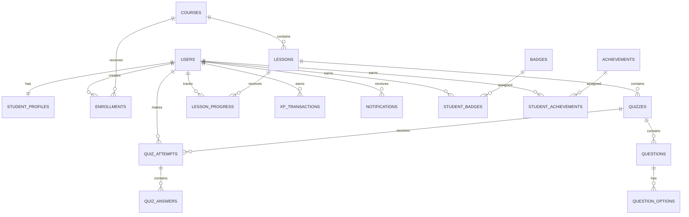

# Emma Learn System Flowchart

## Main System Flow



## Database Relationship Flow



## Important Project Paths

```text
auth/                     Authentication pages
student/dashboard.php     Student dashboard
student/courses.php       Course listing and search
student/course.php        Course details and progress
student/lesson.php        Lesson viewing and completion
student/quizzes.php       Student quiz listing
student/quiz.php          Quiz attempt and results
student/profile.php       Student profile
student/notifications.php Student notifications
student/leaderboard.php   Student leaderboard
admin/dashboard.php       Admin dashboard
admin/courses.php         Course management
admin/lessons.php         Lesson management
admin/quizzes.php         Quiz management
admin/questions.php       Question and option management
admin/students.php        Student management
```
