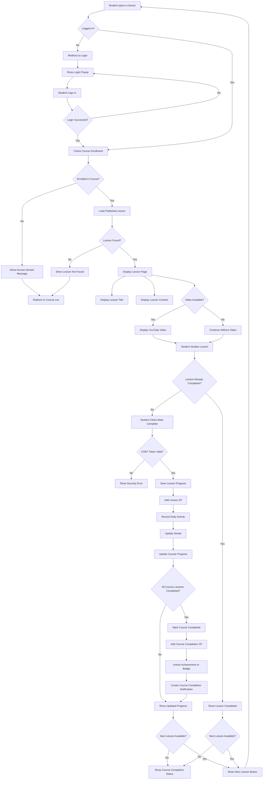
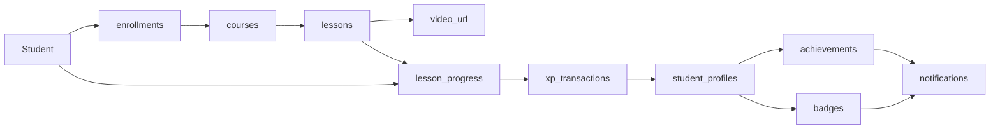

# Emma Learn Lesson Flowchart

## Student Lesson Flow



## Lesson Database Flow



## Lesson Security Rules

- The student must be authenticated.
- The student must be enrolled in the lesson course.
- Only published lessons can be opened.
- Lesson progress is stored for the current student only.
- Completion requests require a valid CSRF token.
- XP is awarded only once for each lesson completion.
- Video URLs are restricted to valid YouTube URLs.

## Related Files

```text
student/lesson.php       Student lesson page
student/course.php       Course lessons and progress
admin/lessons.php        Admin lesson management
includes/gamification.php XP, streaks, badges and achievements
database/schema.sql      Lesson and progress tables
```
